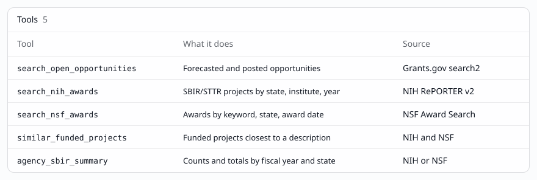

<p></p>

# Federal Funding Finder

A free, open-source, read-only [MCP](https://modelcontextprotocol.io) server for SBIR/STTR and federal grants. It searches Grants.gov, NIH RePORTER and the NSF Award Search API. Every result carries the URL of the record it came from.

- No accounts, no API keys. Queries are not stored or logged. See [PRIVACY.md](PRIVACY.md) and the [terms of use](TERMS.md).
- TypeScript, the official `@modelcontextprotocol/sdk`, streamable HTTP transport, built as a Netlify Function (`/mcp`) with a Netlify Blobs response cache.
- MIT licensed. Maintained by Thel Consulting.



## Tools

All tools are read-only (`readOnlyHint: true`, `destructiveHint: false`) and validate input with zod.

| Tool | What it does | Source |
| --- | --- | --- |
| `search_open_opportunities` | Forecasted and posted funding opportunities. Filters: keyword, agency code (for example `HHS-NIH11`, `NSF`, `DOD`), eligibility codes (`23` is small businesses), status, rows, offset, plus the noise filters below. | Grants.gov search2 |
| `search_nih_awards` | Funded NIH projects. Defaults to SBIR/STTR activity codes R43, R44, R41, R42. Filters: text, org states, institutes (IC), fiscal years, activity codes. | NIH RePORTER v2 |
| `search_nsf_awards` | NSF awards. Defaults to SBIR/STTR Phase I, Phase II and Fast-Track company awards (see the notes below). Filters: keyword (supports AND, OR, NOT), awardee state, award date range, rows, offset. | NSF Award Search |
| `similar_funded_projects` | Takes a project description, extracts key terms, searches NIH and NSF, and ranks funded projects by term overlap. | NIH and NSF |
| `agency_sbir_summary` | SBIR/STTR counts and dollar totals by fiscal year, activity code or program, top organizations, and by state when no state is given. | NIH or NSF |

Grants.gov noise filters (`search_open_opportunities`). Grants.gov keeps listing some records long after they stopped being useful, so these run on the server after each upstream page:

| Parameter | Default | Drops |
| --- | --- | --- |
| `open_only` | `true` | Posted opportunities whose close date is before today (America/Denver). |
| `forecast_max_age_days` | `365` | Forecasts posted more than this many days ago, for example 2024 and early 2025 forecasts that never turned into a posting. `0` turns it off. |
| `rolling_max_age_days` | `1460` | Posted opportunities with no close date that were posted more than 4 years ago, for example the FY 2021 to FY 2023 EDA regional notices. Rolling programs from the last 4 years, such as EDA Public Works (posted 2023), are kept. `0` turns it off. |
| `exclude_no_close_date` | `false` | Every posted opportunity with no close date. Off by default because many are real rolling programs. Forecasts never have a close date on Grants.gov, so it does not apply to them. |
| `posted_after` | none | Anything, posted or forecast, with an open date before this `YYYY-MM-DD` date. |
| `domestic_only` | `true` | State Department overseas posts: agency code `DOS-*` with an agency or title naming a U.S. Mission, Embassy or Consulate (for example `DOS-TUN`, U.S. Mission to Tunisia). Washington bureaus such as `DOS-ECA` stay. |

Each result reports `dropped` (a count per filter), `scanned`, `next_offset` and a note, so nothing is hidden silently. `rows` counts results after filtering: the tool pages through Grants.gov 250 records at a time, up to 1,000 records per call, until it has `rows` results. Pass `next_offset` as `offset` to continue. On 2026-10-17 the research park query (eligibility `12`, `06`, `00`, `02`, `04`, 966 matches) kept 812 records with the defaults and dropped 136 stale forecasts, 9 stale rolling notices and 9 overseas mission notices. Grants.gov already omitted posted records past their close date, so `open_only` dropped none that day.

Notes on the data:

- NIH RePORTER returns one record per project per fiscal year, so a multi-year award appears once per year. Amounts are that year's `award_amount`.
- NSF multi-word keywords are ORed by the API. Use `AND` to require every word.
- NSF summary amounts are total funds obligated to each award, grouped by the fiscal year of the award date.
- NSF's `fundProgramName=SBIR OR STTR` search is a word match, so it also returns outreach and technical assistance, SBIR/STTR operations, the commercialization institute, and research center, I-Corps and fellowship awards that SBIR/STTR money co-funded. Those are dropped: a company award needs a Phase I, Phase II or Fast-Track program component and, from FY1997 on, a title naming the phase ("SBIR Phase I: ..."). For older awards, which NSF titled without the phase, any co-funding program other than SBIR/STTR or EPSCoR excludes the award, so a few pre-FY1997 co-funded company awards are dropped too. `search_nsf_awards` reports what it dropped in `excludedNonCompany`; its `total` is NSF's count before filtering.
- `agency_sbir_summary` is built to finish within about 7 seconds, under Netlify's 10 second function limit. NIH: at most 2,000 records (4 pages). NSF: when the match fits in 24 pages (600 awards) it fetches everything; otherwise it samples each fiscal year, newest awards first, within 40 pages (8 in parallel) and the time budget. Every `byFiscalYear` row has a `status`: `complete`, `partial` (a sample, so count and amount are lower bounds) or `not aggregated` (count and amount are `null`, not 0). `upstreamCount` is the API's exact count per year; for NSF it is before dropping non-company awards. Measured locally, cold cache: NSF all states FY2022 to FY2027 took 5.2 s, NSF all states over 26 fiscal years 6.0 s, NIH all states FY2022 to FY2027 2.5 s.
- SBIR.gov's public API returned HTTP 403 when checked on 2026-10-16, so it is not used.

## Example prompts

- NIH SBIR awards to South Dakota companies since 2020
- Open Grants.gov SBIR opportunities that small businesses can apply to
- Open grants a research park can apply to (nonprofit, higher education, state, city and special district eligibility)
- NSF SBIR awards in South Dakota
- Funded projects similar to a biofilm wound dressing
- NIH SBIR/STTR totals by year for South Dakota

## Connect

Hosted endpoint:

```json
{
  "mcpServers": {
    "funding-finder": { "url": "https://grants.thelconsulting.com/mcp" }
  }
}
```

Docs: https://grants.thelconsulting.com

The same config ships as [mcp.json](mcp.json) for the Cursor plugin ([.cursor-plugin/plugin.json](.cursor-plugin/plugin.json)) and the Grok plugin ([.grok-plugin/plugin.json](.grok-plugin/plugin.json)).

## Local development

Requires Node 20 or later and the [Netlify CLI](https://docs.netlify.com/cli/get-started/) (`npm i -g netlify-cli`). Local dev needs no Netlify account or login.

```sh
npm install
npm run dev            # netlify dev --offline: docs/ on http://localhost:8888, MCP at http://localhost:8888/mcp, local Blobs store
npm run inspect        # MCP Inspector CLI, tools/list against the hosted server (inspect:local for localhost)
npm run demo           # runs the demo prompts against the hosted server, reports timings, writes artifacts/demo-output.json (demo:local for localhost)
npm run stdio          # stdio transport, for clients or Inspector setups that launch a command
npm test               # unit tests plus contract tests that call the real APIs
npm run test:unit      # unit tests only, no network
npm run scan:secrets   # gitleaks if installed, plus grep checks
```

Layout:

- `netlify/functions/mcp.ts`: the MCP endpoint, `POST /mcp` (stateless streamable HTTP, JSON responses).
- `netlify/functions/health.ts`: `GET /health`.
- `netlify/functions/cache-cleanup.ts`: hourly job that deletes expired cache entries.
- `src/`: tools, upstream clients, cache and rate limiter, shared by the function and the stdio entry (`src/stdio.ts`).
- `docs/`: the static site (landing and privacy pages), published as is.

## Deploying

The production site is `federal-funding-finder` on Netlify, served at https://grants.thelconsulting.com (also https://federal-funding-finder.netlify.app). It is deployed from the CLI with `netlify deploy --prod` (publish directory `docs`, functions in `netlify/functions`, both set in `netlify.toml`). Netlify Blobs needs no extra setup on a deployed site.

Environment variables:

- `CACHE_KEY_SALT`: secret used to HMAC cache keys. Set it in Netlify, never in the repo. Without it each function instance uses a random secret and the cache is not shared between instances.
- `ALLOWED_ORIGINS`: optional comma-separated list of extra browser origins allowed to call `/mcp`.
- `RATE_LIMIT_PER_MINUTE`: in-function limiter, default 60.

Origin check: requests with no `Origin` header (Cursor, Grok, the Inspector CLI and other server-side clients) are allowed. Browser requests are allowed only from this site's domains, `localhost` and `ALLOWED_ORIGINS`; other web origins get HTTP 403. This follows the MCP transport rule that servers validate `Origin` to block DNS rebinding.

Rate limiting is per IP, 60 requests per minute. On Netlify it is enforced at the edge by the `rateLimit` rule in `netlify/functions/mcp.ts` (Netlify may take up to about 10 seconds to start blocking). A second limiter in function memory (`RATE_LIMIT_PER_MINUTE`, default 60) also applies per function instance and is what `netlify dev` and the stdio entry use.

## Data sources

- Grants.gov search2 API: `POST https://api.grants.gov/v1/api/search2` ([docs](https://www.grants.gov/api/common/search2))
- NIH RePORTER API v2: `POST https://api.reporter.nih.gov/v2/projects/search` ([docs](https://api.reporter.nih.gov/)). NIH asks clients to keep to about one request per second; summaries page sequentially.
- NSF Award Search API: `GET https://www.research.gov/awardapi-service/v1/awards.json`, falling back to `https://api.nsf.gov/services/v1/awards.json` ([docs](https://resources.research.gov/common/webapi/awardapisearch-v1.htm)). The service moved to Research.gov; the old host still answers.

This project is not affiliated with or endorsed by any federal agency.

## Support

- Questions, bugs and feature requests: [GitHub issues](https://github.com/Thel-Consulting/funding-finder-mcp/issues).
- Security problems: report privately, see [SECURITY.md](SECURITY.md).
- Contributing: see [CONTRIBUTING.md](CONTRIBUTING.md).

The hosted service is free and provided as is, with no uptime promise. See [TERMS.md](TERMS.md).

## Design

Visuals follow the [Quartz design system](https://github.com/arla6ka/skills/tree/main/systems/quartz) by Arlan Marat (MIT). [docs/vendor/quartz/tokens.css](docs/vendor/quartz/tokens.css) is an unchanged copy with its license. Token notes are in [design/quartz-tokens.md](design/quartz-tokens.md).

## License

MIT. See [LICENSE](LICENSE).
